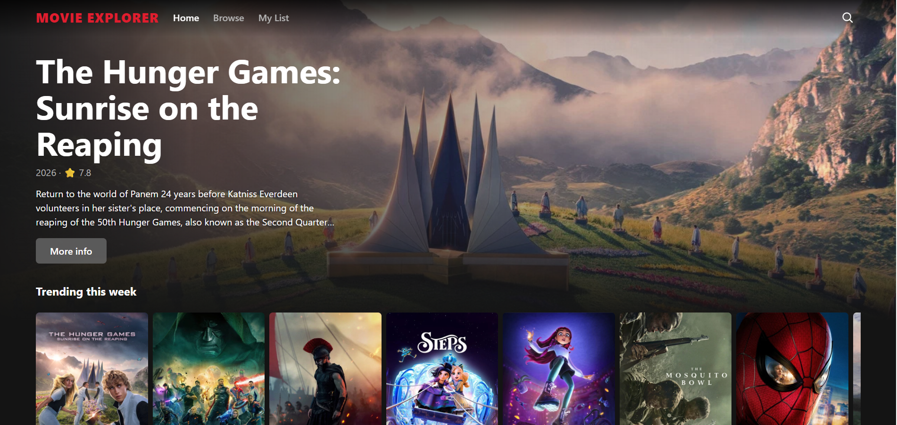
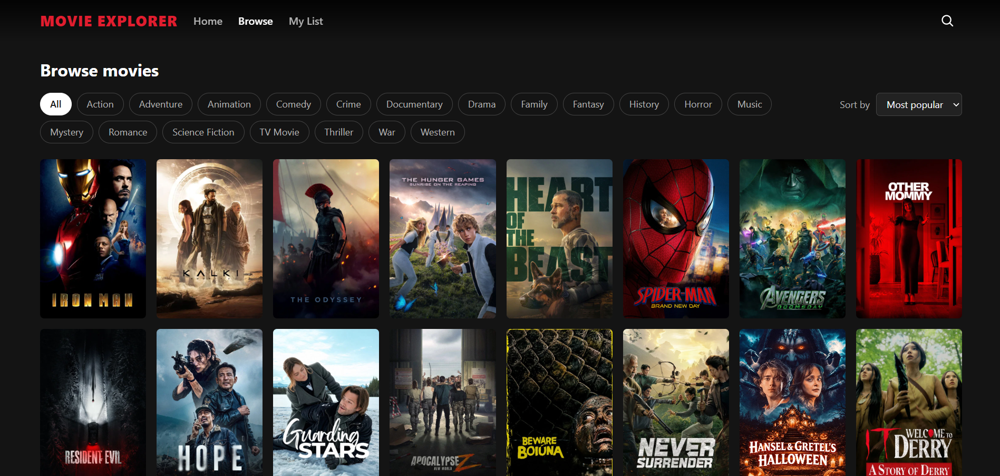
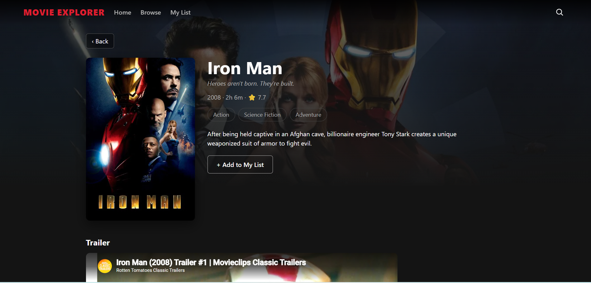
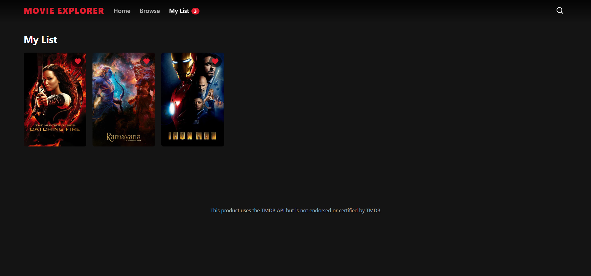

# Movie Explorer

A Netflix-style movie browser built with React and the TMDB API. Browse trending titles, search with debounced input, filter by genre, watch trailers and see the cast, and save favorites to a personal list.

**Live demo:** [https://movie-explorer-gamma-pink.vercel.app]



| Browse with filters | Movie details | My List |
| --- | --- | --- |
|  |  |  |

## Features

- Home page with a featured banner and horizontally scrolling rows (Trending, Popular, Top rated, Upcoming)
- Debounced search with a results page and an empty-state message
- Browse page with genre filters, sorting and "Load more" pagination; filters are stored in the URL
- Movie detail page with overview, runtime, genres, trailer and cast
- Favorites saved in localStorage, with a "My List" page and a count in the navbar
- Loading skeletons, error messages with retry, and a 404 page
- Responsive layout and keyboard-friendly focus styles

## Tech stack

React, Vite, React Router, plain CSS, TMDB API, Vercel (hosting and a serverless function)

## How it works

The browser never calls TMDB directly in production. Requests go to a small serverless function (`api/tmdb.js`) on Vercel, which adds the API token on the server and forwards the request. This keeps the token out of the front-end code and lets the site work for visitors whose networks block TMDB.

## Run it locally

1. Clone the repo and run `npm install`
2. Create a free account at themoviedb.org and copy your API Read Access Token
3. Create a file named `.env.local` in the project root:
   ```
   VITE_TMDB_TOKEN=your_token_here
   ```
4. Run `npm run dev` and open the address it prints

## What I learned

- Fetching real API data and handling loading, error and empty states
- Routing with React Router and keeping search and filter state in the URL
- Sharing state with React Context and persisting it with localStorage
- Writing a serverless proxy to protect an API token and work around network blocking
- Deploying a React app to Vercel with environment variables

## Ideas for next steps

- User accounts so favorites sync across devices
- Infinite scroll on Browse
- Tests for key components

## Credits

This product uses the TMDB API but is not endorsed or certified by TMDB.
